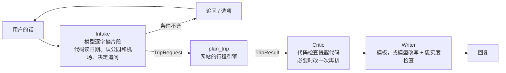

# NPS Guide Copilot

LLMOps 课程项目的 Copilot 部分。总体计划见 [docs/LLMOPS_PLAN.md](../docs/LLMOPS_PLAN.md)；这里说已经做好的部分怎么用。

## 现在有什么（阶段 1：契约和工具，2026-10-17）

原则：**LLM 负责理解需求和解释结果，行程由网站现有的确定性引擎排**。Copilot 把用户的话整理成一个 `TripRequest`，交给 `plan_trip` 工具，拿回 `TripResult` 再去检查、解释。

| 文件 | 内容 |
|---|---|
| `contracts/trip-request.v1.schema.json` | 输入契约（JSON Schema 2020-12）：公园（1–4 座，第一座是主公园，其余要在它的 `nearby` 里）、`startDate` 或 `month`、天数（1–14）、出发地和回程地（常用机场三字码，或者名字加坐标）、节奏、住宿偏好、同行的人（最小孩子几岁、婴儿车、老人、轮椅），以及每个字段的来源 `provenance`（用户原话 / 用户确认 / 默认值 / 推断，附原文片段）。和网站“自动生成攻略”的表单 `WizardInput` 一一对应 |
| `contracts/trip-result.v1.schema.json` | 输出契约：每天的日期、时区、日出日落、出发和回住处的时间、开车和活动分钟数、当晚住处、每一站几点到几点（别的时区的景点另给 `localStart`）、提醒代码（`afterHours`、`tempClosed`、`parkingFull`……，见 `src/lib/copilot/contract.ts` 的 `STOP_WARNINGS`），没排进去的景点和原因，以及这次计算的假设（`assumptions`） |
| `contracts/parks.json`、`contracts/airports.json` | 59 座公园和名胜（代码、简繁英名字和别名、时区、常用机场、常一起玩的公园）、86 个机场。Intake 认公园名、机场就用这两个，不要在 Python 里另写一份 |
| `contracts/examples/` | 样例请求 |

这些 JSON 都是 `npm run copilot:contracts` 从 TypeScript 生成的（来源是 `src/lib/copilot/contract.ts`、`src/data/parks.ts`、`src/data/airports.ts`），不要手改；`tests/copilot-plan.test.ts` 检查文件和代码一致。繁简对照表 `hant-to-hans.json` 收的是 `copilot/nps_copilot/` 里 `.py` 和提示词文件出现过的汉字，**改了这些文件、加了新汉字也要重跑**，不然 CI 的网站测试会失败（PR #6 碰到过）。改契约字段要升版本号（`trip-request/v2`），旧的评测记录才对得上。

## 怎么调用 plan_trip

命令行（不联网，同样的输入和日期每次结果一样）：

```bash
REFERENCE_DATE=2026-10-16 npm run copilot:plan -- copilot/contracts/examples/yose-4d-fat.json
```

HTTP（开着 `npm run dev` 时）：

```bash
curl -X POST "http://localhost:3000/api/copilot/plan?reference=2026-10-16" -H "Content-Type: application/json" --data-binary @copilot/contracts/examples/zion-page-month-las.json
```

- `reference` / `REFERENCE_DATE` 是“今天”：只给了月份时按它算最近的那个月（2026-10-16 时说 3 月就是 2027 年 3 月）。评测时一定要固定，结果才能复现。
- 请求不合格：命令行退出码 2，HTTP 返回 400，内容是 `{"error": "invalid_request", "issues": [{"path": "/days", "message": "不能大于 14"}]}`。`path` 是 JSON Pointer，Copilot 可以按它追问用户。
- 网站设了 `SITE_PASSWORD` 时，HTTP 接口和别的接口一样要先登录；本机开发不设密码就不用。

## 和行程页不一样的地方（结果的 `assumptions` 里会写）

- 行程页从机场到各景点的车程是浏览器里现查 OSRM；这里用预先算好的“机场 → 公园定位点 → 景点”，可能差几十分钟。不是常用机场的地点按直线距离估算。
- 不读 NPS 实时公告，只按仓库里整理的临时关闭（`src/data/closures.ts`）。要的话调用方查好，用 `live` 传进 `planTrip`。
- 只给了月份时，日出日落、班次、临时关闭按那个月 15 号起算。

## 阶段 2：Python 的 Copilot（2026-10-17）



| 文件 | 内容 |
|---|---|
| `nps_copilot/intake.py`、`prompts/intake_v1.txt` | Intake：模型只从当前这条消息里逐字摘片段（公园、日期、天数、出发地、回程地、同行的人、偏好），代码检查片段确实在原话里（先规范化，“6天”“6 天”算一样），再读成代码、日期、天数，管对话状态，决定下一句问什么。没说年份的按“今天”（`reference_date`）给候选年份让用户确认；否定过的候选不会被后来的“是的”确认；先说的年份和后来补的月日合起来；“我选第二种”“缅因那个”都能对上选项。模型漏掉、原话写得很清楚的天数用规则补（trace 里记 `rule_filled`） |
| `nps_copilot/catalog.py`、`dates.py`、`text.py` | 按 `contracts/parks.json`、`airports.json` 认公园和机场（加上常用简称和英文城市名 `data/airport_cities_en.json`），读日期和天数，文本规范化 |
| `nps_copilot/plan_client.py` | 调 plan_trip：默认直接跑仓库里的 Node 命令行（不用开网站），设了 `COPILOT_PLAN_URL` 走 HTTP |
| `nps_copilot/critic.py` | Critic：把每天、每站的提醒代码整理成 findings（hard / soft）；节奏是默认值、又有几天太满时改成轻松再排一次，用户自己说的节奏、天数、公园不擅自改；最多改一次 |
| `nps_copilot/writer.py`、`prompts/writer_v1.txt` | Writer：默认按模板写（只用结果里的事实）；`--writer-model` 时让模型改写，再检查说明里的时间、数字都在结果里，对不上就退回模板 |
| `nps_copilot/providers.py` | 模型提供方：本机 Ollama（默认 `qwen3.5:4b-q4_K_M`，参数和实验一样）、回放录好的输出（CI 用）、录音、测试用的脚本、云端（留接口、默认关） |
| `nps_copilot/pipeline.py` | 把上面串起来；每轮写一条 JSONL 日志到 `copilot/runs/`（提示词版本和 hash、模型、各步耗时、模型输出、丢掉的片段、规则补的、Critic 的发现、Writer 有没有退回模板） |
| `nps_copilot/api.py`、`__main__.py` | HTTP 服务（FastAPI）和命令行对话 |
| `tests/` | pytest：Intake 每个修好的问题各有测试、Critic、Writer 的忠实度检查、接真行程引擎的端到端 |
| `eval/` | 评测：`cases/intake-v1.jsonl` 25 组对话和期望结果，`run.py` 跑分，`recordings/` 录好的本机模型输出，`baseline.json` 门禁基线，结果见 [eval/RESULTS.md](eval/RESULTS.md) |

### 怎么跑

```bash
pip install -e "copilot[dev,api]"            # Python 3.11 以上；plan_trip 要 Node 24
# 开本机模型（实验目录里的便携 Ollama，模型已经下好）：
powershell -File experiments/local-model-validation/start-local.ps1
cd copilot
python -m nps_copilot chat --reference 2026-10-16             # 命令行对话
python -m nps_copilot serve                                    # HTTP 服务：POST /sessions、POST /sessions/{id}/messages
python -m pytest -q tests                                      # 单元测试和端到端测试
python eval/run.py --plan                                      # 真模型评测
python eval/run.py --record                                    # 真模型评测并重新录音（改了提示词或样例以后）
python eval/run.py --replay eval/recordings/qwen3.5_4b-q4_K_M.jsonl --gate eval/baseline.json --plan   # CI 跑的门禁
```

环境变量：`COPILOT_PROVIDER`（`ollama` / `replay` / `cloud`）、`COPILOT_MODEL`、`OLLAMA_HOST_URL`（默认 `http://127.0.0.1:11435`）、`COPILOT_REPLAY`、`COPILOT_PLAN_URL`、`COPILOT_RUNS`、`COPILOT_ALLOW_CLOUD`、`COPILOT_PROMPT_INTAKE`、`COPILOT_PROMPT_WRITER`（提示词版本，比如 `v1`）、`COPILOT_BUILD_SHA`（镜像构建时写入）。

### CI

`.github/workflows/ci.yml`：每个 PR 跑网站的 lint、类型检查、测试，和 Copilot 的 pytest、回放评测门禁（低于 `eval/baseline.json` 就失败），评测报告作为 artifact 上传。CI 上不调真模型。**改了提示词、样例或模型**，回放记录就对不上了（门禁会报“回放记录里没有这次调用”）：先在本机用真模型 `--record` 重新录，看分数，再更新 `baseline.json` 一起提交。

## 阶段 3：Docker、发版、回滚、提示词版本（2026-10-17）

详细步骤见 [RELEASE.md](RELEASE.md)。

| 位置 | 内容 |
|---|---|
| `nps_copilot/prompts.py`、`prompts/defaults.json` | 提示词版本：`<任务>_v<n>.txt`，默认版本写在 `defaults.json`，`COPILOT_PROMPT_INTAKE` / `COPILOT_PROMPT_WRITER` 临时换版本；日志和 `/health` 都记版本和 hash |
| `prompts/intake_v2.txt` | 没采用的实验版本：回归集 39/40（v1 是 37/40），开发集 24/25（v1 是 25/25），门禁挡住了，留着演示回滚 |
| `nps_copilot/monitor.py` | `python -m nps_copilot stats [--days 7]`：按 Copilot 版本和提示词版本统计运行日志，决定要不要回滚 |
| `Dockerfile`、`../.dockerignore`、`docker-compose.yml` | 镜像（Node 24 + Python，行程引擎和 Copilot 都在里面，模型在宿主机的 Ollama）；`COPILOT_TAG` 选版本，`COPILOT_PORT` 换端口 |
| `scripts/smoke.py` | 冒烟测试：`/health`、版本对不对、一句完整的需求能不能排出行程（`--message`、`--days` 换一句话） |
| `../.github/workflows/release.yml` | 推 `copilot-v*` tag 发版：测试和门禁 → 构建 → 冒烟 → 推 GHCR → 拉回来再冒烟 → GitHub Release |

CI 也多了一个 `docker` job：每个 PR 构建镜像、用回放模型冒烟测试。命令行多了 `python -m nps_copilot version`、`stats`，`serve` 可以指定 `--host`、`--port`。

## 下一步（阶段 4、5）

- 另写一批改代码时不看的评测样例（现在的 25 组是开发集），加上 Writer 的成批评测、对照实验（单模型直接回答 vs 流水线，有没有 Critic）。
- 网站行程页上的对话面板。
