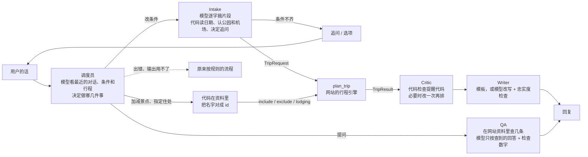

# Copilot 技术参考 / Copilot Reference

Copilot 是怎么设计的、每个文件做什么、提示词和评测怎么管。**怎么安装、运行、发版、回滚**见 [GUIDE.md](GUIDE.md)；**做到哪一步、为什么这么定**见 [PROJECT.md](PROJECT.md)；**评测成绩**见 [copilot/eval/RESULTS.md](../copilot/eval/RESULTS.md)。

**English summary.** The LLM understands the request and explains the result; the website's deterministic engine plans the trip. Intake has the model quote spans verbatim, and code validates them, reads dates and places, and owns the dialogue state. A complete `TripRequest` goes to the `plan_trip` tool, which wraps the same `generateTrip` the website uses. A code-only Critic checks the `TripResult` and may revise once. The Writer uses a template by default, or a model rewrite behind a faithfulness check. Contracts are JSON Schema generated from TypeScript. Prompts are versioned files. Every turn is logged as JSONL with versions and hashes, and CI gates on replayed recordings because there is no GPU there.

## 原则和流程

**LLM 负责理解需求、决定做什么、解释结果，行程由网站现有的确定性引擎排。** 每一轮先由调度员（模型）决定这句话要做哪几件事，再由代码去做：条件整理成 `TripRequest` 交给 `plan_trip` 工具，拿回 `TripResult` 再检查、解释；问题去网站资料里查了再答。

- **调度员**（`dispatcher.py`，提示词 `dispatch_v1`）：模型看最近 4 轮对话、现在的条件、现在的行程（每天去哪、住哪）和最新一句，输出要做的几件事（`{"actions": [...]}`，最多 4 件，按用户说的顺序）：`conditions` 改条件或回答追问、`ask` 提问（附一句按上下文补全的问法，“那条步道”→“雾径”）、`add_stop` / `remove_stop` 加减景点、`set_lodging` 指定某晚住处、`new_trip` 重新开始、`chat` 道谢闲聊。模型只出“做什么”，不出事实：
  - 景点、住处的名字必须是这句话或最近对话里说过的，模型编的丢掉（trace 记 `dropped`）；代码在这次行程公园的资料里把名字对成 id（`knowledge.resolve`），对不上的告诉用户“没找到”，不瞎改；
  - 条件照旧由 Intake 从原话里摘、代码读；“那就 7 月 10 日出发”这种指前面说过的公园的，调度员给出公园名、代码核对是对话里出现过的才用；
  - 问题交给 QA：模型按用户原话回答，补全的问法只帮着找资料（补全有时会补错，比如把“19 号几点出发”补成“从 El Portal 出发”）；
  - 用户的改动（`include`、`exclude`、每晚住处）记在会话里，换了公园、改短天数以后对不上的自动不带；“帮我安排一个新的行程”全部清掉。
- **代码兜底**（10-18 第三次试用后加的）：还没排出行程时每一句都先交给 Intake（这时用户多半在回答追问）；一看就是在问的（问号、“什么”、“吗”）调度员没列提问也补上；补全的问法只在原话用了代词（那、这、它、呢、it、that）时才用；“那就加上它吧”这种代词，用户上一句正好点了一个地方就以它为准；Intake 认不出的叫法只看这一句，说了片区、州又没说“都去”的列出这几座来问。
- **退回规则**：调度员调用失败、输出用不了，或者用户只是在回答上一句追问（像回答的短句：“5”“5天”“是的”“第二个”；“雷尼尔山呢？”这种不算），走原来按规则的流程（`pipeline._legacy`），不会因为调度员出错就答不了。`COPILOT_DISPATCH=0` 整个关掉调度员（对照实验、回滚用）。

- **Intake**：模型只从当前这条消息里逐字摘片段（公园、日期、天数、出发地、回程地、同行的人、偏好），代码检查片段确实在原话里（先规范化，“6天”“6 天”算一样；摘了原话里没有的就丢掉，记 `dropped_spans`），再读成代码、日期、天数，管对话状态，决定下一句问什么。“今天、明天、这周六、下周末、19号、下个月5号、tomorrow”按“今天”（`reference_date`）算成具体日期（`dates.relative_date`），模型没摘到时规则补；没说年份的月日：今年还没到的按今年、过去两个月以上的按明年，回复里说一句按哪天排，只有刚过去不久的才问是哪一年；否定过的候选不会被后来的“是的”确认；先说的年份和后来补的月日合起来；“我选第二种”“缅因那个”都能对上选项。
- **规则补**：模型漏了、但原话写得毫不含糊的天数（“N天 / N日 / N晚 / 一周”各最多一处）和公园名（模型一个都没摘时按目录认），用规则补上，trace 里记 `rule_filled`，评测时和模型的成绩分开算。
- **Critic**：把每天、每站的提醒代码整理成 findings（hard / soft）；节奏是默认值、又有几天太满时改成轻松再排一次。用户自己说的节奏、天数、公园不擅自改；最多改一次。
- **Writer**：默认按模板写（只用结果里的事实）：每天几点从哪出发、开多久，晚上住哪，最后一天开回机场要多久、几点到；第一站超过 4 小时的提醒、列出近一些的常用机场；住民宿附 Airbnb 链接；没排进去的写清楚原因（季节性的写一年里什么时候才有）。打开模型改写时，再检查说明里的时间、数字都在结果里，对不上就退回模板。
- **多轮**：排出行程以后再说话，条件或改动变了先说改了什么（“好，改了：不去马里波萨巨杉林、第 1 晚住 El Portal。”）、哪几晚换了住处，再给新行程；点名要去、但这几天去不了的说清楚为什么没排；条件没变的不重印行程：“好的、谢谢”简短回一句，提问交给 QA。一句话里几件事的（改天数又问问题、去掉一个换成另一个），按顺序都做。还没排出行程时的提问先回答再接着追问。刚问了“玩几天”“孩子几岁”，只回一个数（“5”）也算。（调度员关掉时，原来的规则是：Intake 摘不出新条件、行程没变才算提问；“新的行程”“start over”这类说法按正则认。）
- **按片区、州说的一组公园**：“西雅图附近的三个国家公园都玩”“华盛顿州的国家公园都去”按网站的片区和州换成具体的公园（不超过 4 座），回复里说一句是哪几座；只是问“是哪三个”的不换，交给 QA。
- **边做边报**（10-22，GOALS O65）：`POST /sessions/{id}/messages?stream=1` 一行一个 JSON：做到哪一步报一次 `{"type": "progress", "step": ...}`——`understand`（调度员）、`read`（Intake 读条件）、`alerts`（真要现读 NPS 公告时才有，带公园）、`plan`（带认出的条件：公园、日期或月份、天数、出发地）、`write`（带景点数）、`answer`（回答问题），最后一行 `{"type": "reply", ...}`。网站的中转（`/api/copilot/chat`，`stream: true`）原样转给浏览器，对话框按真实的步骤打勾，不按时间假装走进度。
- **QA（回答问题，RAG）**：`knowledge.search` 在 `knowledge.jsonl`（网站数据整理成的 1687 条短文：景点、住处、公园、片区、州、特别活动、临时关闭）里找 4 条，只在这次行程的公园里找（问题里点名了别的公园就加上那座；片区、州的资料不分公园，问题里说了它的名字才用）。问的是行程里的景点整体（“这些景点好看吗”）时，另外把每一站的一句介绍给模型。问题里直接出现了某条的名字（“El Portal”）的排最前面，“雾径 · 弗纳尔瀑布”只说“雾径”也算；其余按 BM25（中文按相邻两个字切，英文按单词）。模型只看“行程 + 这 4 条”回答，输出 `{found, answer, sources}`；代码检查回答里的时间、数字都在行程或资料里出现过（按整个数比）、引用的编号是给过的，对不上就不用模型写的、改成摘资料原文（问题里点了名的那条），资料里没有就说不知道。回答后面注明用了哪几条资料。不用向量检索、不另外下载模型；以后可以换成嵌入模型做对照实验，接口不变。
- **查询工具**（`tools.py` → `scripts/lookup.mjs` → `src/lib/copilot/lookup-tool.ts`，10-21，计划书的 is_open、drive_time、search_attractions）：资料里没有现成一句话、要算的问题，QA 先调网站的查询工具，结果和资料一起给模型（“[0] 查询结果”，模型照这个回答；模型出错或数字对不上时直接把查询结果给用户）。和 plan_trip 一样是 Node 命令行、不联网、同样的输入结果一样。三种：
  - `is_open`（某个景点、或者原话里说到的季节性山路某天能不能去）：一条条列依据——临时关闭（`closures.ts`）、季节性山路往年这一天通车的年数、开放月份（路通了就能去的景点不看月份）、游船导览这天有没有班次、开放时间、许可；结论是能去 / 去不了 / 多半去不了（按往年估）/ 说不准。路名认括号前后两半、空格不算（“120号公路”），另加几个常说的（向阳大道、泰奥加）。
  - `drive_time`（两地开车多久）：景点、住处、营地之间查车程表；机场先开到公园定位点再算；不通公路的（夏威夷和本土）是 null，不报 12 小时的假数。只点了一个景点的从行程里住在这座公园附近的那晚出发；问“从机场”的按这次的出发机场；只点了一个住处（“El Portal 离园区多远”）的不查，住处的资料里写着，按公园定位点算的数和它对不上。
  - `search`（按条件找景点）：公园、类型（步道、瀑布、观景点……）、步道长度（英里或公里）、难度、不用许可、同行的人（孩子几岁、老人、轮椅、婴儿车，按同行适合度，不适合的不列）、日期（那天去不了的不列）；必去的、园内热度高的排前面，最多 8 个。
  - 认问题、认地方、认日期都是代码：问题按正则分（开没开 / 多远多久 / 有哪些适合）；地方按资料里的名字，最长的优先、这次行程的公园优先；日期按原话（“1月15号”“下周六”，只说月份按 15 号）→“第 3 天”→这个景点排在行程哪天→行程第一天。trace 的 `qa.tools` 记下查了什么、几行、多久。`COPILOT_TOOLS=0` 关掉。
- **问没排进去的**（10-21）：回复里只写前 6 个“等 26 处”；问题里说到“没排”“去不了”“为什么没去”的，把完整的没排进去的清单按公园分、带原因给模型。
- **打错字反问**（10-19）：认不出的公园叫法和所有公园的叫法比像不像（`catalog.similar`，去掉“国家公园”后 difflib 相似度至少 0.6，两个字的名字首字相同也算），像就反问“你说的“奥林匹亚”是奥林匹克吗？”（`confirm_park`），回是加上、回不是不算、答别的当不是；不像的、前面已经认出别的公园的，说一声“没认出……先没算进去”，不再悄悄丢掉。不把错字当别名加进叫法表。
- **读 NPS 公告提取临时关闭**（`alerts.py`、提示词 `alerts_v1`，10-19）：`npm run alerts:fetch` 抓所有公园的公告快照（`copilot/data/alerts/latest.json`，不提交），`python -m nps_copilot alerts` 让模型一条条读：从这座公园的景点名单（`contracts/attractions.json`）里选出关了的、读出起止日期。代码核对：证明关闭的原话（evidence）要在公告里，不在就不算关闭；日期要是公告里写到的（“through Nov 19”可以算成 20 日重开）；选的景点公告里要提到（全名、名字里够特别的词或片区）。输出 `closures-latest.json` 用模型和规则（网站的 `closedByAlerts`）的并集，每条记 `found_by`。
- **公告关闭接进排行程**（`src/lib/copilot/live.ts`，10-19）：`plan_client` 调行程引擎时，`copilot/data/alerts/closures-latest.json`（或 `COPILOT_LIVE_CLOSURES` 指的文件）存在就交给它（命令行的 `LIVE_CLOSURES`；走 HTTP 时网站服务器自己设 `LIVE_CLOSURES`）。和行程页读实时公告一样只管今天起两周内出发的；清单要是新的（比“今天”早 3 天以内、不比“今天”晚），公告写了起止日期的，这趟一天都碰不到就不算，碰到了整趟都当关着。**按把握分两档**：规则也找到的（`strict`，公告标题里写着这个景点，和行程页按公告不排的规则一样）不排，`skipped` 里 `reason: closed`、附 `alert`（公告标题、链接、重开日期），Writer 说“NPS 最新公告说暂时关闭，11 月 2 日重开”；只有模型找到的照排，那一站加警告 `alertMaybeClosed` 和 `alert`，Writer 在“要注意”里说“NPS 最新公告里提到它可能关了，出发前确认”。为什么：10-19 的评测里只有模型找到的景点 10 个对 4 个（Biscuit Basin 的公告被说成老忠实泉关了），直接不排会白白少去热门景点；模型准了再放宽。仓库里人工核对过的 `closures.ts` 优先；`assumptions` 写 `live-alerts:` 或 `no-live-alerts(原因)`。评测和测试里 `COPILOT_LIVE=0`，结果才能复现。
- **只读新的、聊天时现读**（`alerts_live.py`，10-19）：读过的公告按“id + 更新时间 + 提示词版本”记进 `copilot/data/alerts/extracted.json`，同一条没改过就不再交给模型，每晚只读新出现、改过的几条；模型出错（额度用完、服务忙）的那条这次按规则算、不进缓存，下次再试。读公告的模型由 `COPILOT_ALERTS_PROVIDER`（gemini / openai / ollama / rules）定，没设时有 `GEMINI_API_KEY` 就用 Gemini 3.5 Flash Lite，没有就用本机。聊天时：`plan_client` 调行程引擎之前，两周内出发、要去的公园今天还没读过，就当场只抓这几座公园的公告读一遍，合进关闭清单（清单里每座公园记下哪天读的，`live.ts` 按要去的公园里最旧的那份看新不新）；出错就用原来的清单，trace 的 `plan.alerts` 记下读了什么
- **每晚读公告**（`.github/workflows/alerts-nightly.yml`，`copilot/scripts/alerts_report.py`）：每天加州时间 0 点（UTC 7 点、8 点各触发一次，每个加州日子第一次触发的那次往下跑：先查今天有没有别的定时那次已经读过公告；GitHub 的定时常常晚点，10-20 以前只认“加州正好 0 点那一小时”，晚一个多小时两次都会跳过）抓所有公园的公告快照（存成 artifact `nps-alerts-snapshot`，留 30 天），以前没报过的关闭公告（分类 Park Closure 或标题写着 closed / closure）开一个 issue（标签 `nps-alerts`，正文里 `<!-- alert:ID -->` 记下报过的）；评测集快照里的算报过。CI 上没有模型，只用规则看一眼；用模型提取要在本机下载快照跑 `python -m nps_copilot alerts --snapshot <快照>`。新的关闭公告是模型没见过的数据，留着做 `alerts_v2` 的评测。
- **每晚的闭环**（10-20，仓库主人定的“模型提议、人来批”，不直接取代人工核对的 `closures.ts`：公告只说现在开没开，很多条目的重开日期、“要修好几年”来自各公园的路况页；`closures.ts` 也是给模型打分的标准答案）。读完公告以后接着做三件事：
  1. **抽查**：同一串模型再读评测集里固定的 26 条（`eval/alerts.py --chain --sample 26`，和 10-20 对照同一批），类型准确率低于 80% 或景点 F1 低于 0.5（`eval/baseline-alerts-canary.json`，比 MiniMax 的 92%、0.67 低一档，26 条里关了网站景点的只有 6 个）就开 `alerts-quality` issue（已经有开着的就在下面评论）。模型换了（MiniMax 额度用完换到下一家）、NPS 改了公告写法、提示词不行了都会在这里露出来。每晚多约 26 次调用，仓库变量 `ALERTS_CANARY` 设成 `0` 就不抽查。
  2. **提议**：`scripts/propose-closures.mjs`（`npm run alerts:propose`）把公告标题里写着景点（规则认，模型也读了的标“模型 + 规则”）、还没过重开日期、`closures.ts` 里还没有、不是季节性山路、以前没报过的关闭写进 `closures.ts`（说明先用公告标题，英文表跟着加），推到 `bot/closures-<日期>` 分支；`npm run check:closures` 列出的“可能已经重开”“重开日子已过”也写进同一段。issue 里给一个开 PR 的链接，人看过、把说明改成中文、写上替代办法再合并。为什么不让工作流自己开 PR：仓库设置里没开“允许 GitHub Actions 创建 PR”，而且机器人开的 PR 不会触发 CI，必需的三项检查跑不了；人点链接开的 PR 照常跑 CI。
  3. **发布**：当晚的关闭清单（`closures-latest.json`）推到 `data/alerts-live` 分支（只有这一个文件和说明，每晚有变化才加一个提交）。网站的 `/api/alerts` 一小时读一次（`src/lib/alerts-live.ts`，仓库公开，读 raw 文件），返回 `extracted`；行程页的自动生成攻略和出发前表单用 `withExtracted`（`src/lib/copilot/live.ts`）：公告标题对到的关闭里，模型读出起止日期、这趟一天都碰不到的去掉，模型和规则都认、标题匹配漏掉的加上，只有模型找到的不动——和 Copilot 的规矩一样。清单旧了（3 天以上）、读不到就照旧只按公告标题。
- **商业 API 对照**（`providers.py` 的 `GeminiProvider`、`OpenAIProvider`，10-19）：同样的提示词和代码核对，只换模型。读公告这一项 GPT-4.1 mini 最准（景点 F1 0.61，本机 4B 0.33），Gemini 3.5 Flash Lite 免费、差得不多（0.54），GPT-5 nano 最差（0.14），见 [RESULTS.md](../copilot/eval/RESULTS.md)。默认还是本机模型
- **网站行程页的对话框**（`src/components/plan/copilot-chat.tsx`、中转接口 `src/app/api/copilot/chat/route.ts`，10-19）：浏览器 → 网站的 `/api/copilot/chat` → Copilot 服务（`COPILOT_URL`，默认 `http://127.0.0.1:8765`）。`GET` 看 Copilot 开着没有（要像 Copilot 的 `/health` 才算，端口上是别的程序也不算），没开就不显示对话框；`POST {text, session}` 没有会话先开一个，Copilot 重启过（会话没了）就开个新的再说一遍。`plan_trip` 的结果里多了 `trip`（网站的 Trip：每天的景点、每晚住处、攻略说明），排出行程时对话框把它原样放进行程页，页面上看到的就是 Copilot 说的那一份；第一次换掉已有的行程前问一声，之后接着说改出来的直接换，只是回答问题、行程没变的不重新放（不冲掉手动调整）。追问带选项的（选公园、机场、节奏）显示成按钮。部署在 Vercel 上时连不到 Copilot，对话框不出现
- **公园名在别的地方名字里**：“冰川点”是优胜美地的景点，里面的“冰川”不当成冰川国家公园（`knowledge.inside_place_name`，记在 trace 的 `ignored_parks`）；只在那个地方属于别的公园时才不算（“大峡谷村”还是大峡谷）。

## 契约：Copilot 和行程引擎之间的约定

| 文件 | 内容 |
|---|---|
| `copilot/contracts/trip-request.v1.schema.json` | 输入（JSON Schema 2020-12）：公园（1–4 座，第一座是主公园，其余要在它的 `nearby` 里）、`startDate` 或 `month`、天数（1–14）、出发地和回程地（常用机场三字码，或者名字加坐标）、节奏、住宿偏好、同行的人（最小孩子几岁、婴儿车、老人、轮椅），以及每个字段的来源 `provenance`（用户原话 / 用户确认 / 默认值 / 推断，附原文片段）。和网站“自动生成攻略”的表单 `WizardInput` 一一对应 |
| `copilot/contracts/trip-result.v1.schema.json` | 输出：每天的日期、时区、日出日落、出发和回住处的时间、开车和活动分钟数、当晚住处、每一站几点到几点（别的时区的景点另给 `localStart`）、提醒代码（`afterHours`、`tempClosed`、`parkingFull`……，见 `src/lib/copilot/contract.ts` 的 `STOP_WARNINGS`；`familySerious` 是同行适合度给的：能去，但对同行的婴儿或老人风险高、很累，Critic 当 hard，Writer 一定会说“请务必慎重考虑”）、没排进去的景点和原因，以及这次计算的假设（`assumptions`） |
| `copilot/contracts/parks.json`、`airports.json` | 59 座公园和名胜（代码、简繁英名字和别名、时区、常用机场和开过去的分钟数 `airportMinutes`、常一起玩的公园）、86 个机场。Intake 认名字就用这两个，不在 Python 里另写一份 |
| `copilot/contracts/hant-to-hans.json` | 繁简对照表：网站同一套 OpenCC，收的是公园和城市名、`copilot/nps_copilot/` 里 `.py`、提示词、`data/*.json`、`knowledge.jsonl` 出现过的汉字的台湾、香港和标准繁体写法（不是完整的繁简字典）；本身就是简体字的不收（OpenCC 把“么”当成“幺”的繁体，以前“什么”会被转成“什幺”） |
| `copilot/contracts/knowledge.jsonl` | QA 用的资料，一行一条 `{id, type, park, title, names, text}`：公园（介绍、最适合的月份、季节、片区、机场）、景点（介绍、停留、步道长度和爬升、开放月份、关闭说明、许可、开放时间、提示、带小孩老人）、住处（说明、开到这座公园必去景点各要多久）、网站的片区（有哪几座、常一起玩的）、各州的国家公园（美国 63 座，网站没收录的也列出来；片区和州有 `members`，Intake 按它换成公园）、特别活动、临时关闭。由 `scripts/build-copilot-knowledge.mjs` 从网站数据生成 |
| `copilot/contracts/examples/` | 样例请求 |

- 这些 JSON 都是 `npm run copilot:contracts`（`scripts/build-copilot-contracts.mjs`）从 TypeScript 生成的，来源是 `src/lib/copilot/contract.ts`、`src/data/parks.ts`、`src/data/airports.ts`，`knowledge.jsonl` 还用到景点、住宿、活动、临时关闭、同行适合度和车程表，不要手改；`tests/copilot-plan.test.ts` 检查文件和代码一致。**改了 Copilot 的 Python 文件、加了新汉字、改了景点住宿这些数据都要重跑**，不然网站测试会失败。
- 改契约字段要升版本号（`trip-request/v2`），旧的评测记录才对得上。只加可选字段不升（10-18 给 TripResult 加了每天的 `returnDriveMin`、住处的 `rental` 和 `airbnbUrl`、没排进去的 `openMonths` 和 `noteZh`；给 TripRequest 加了用户的改动：`include` 点名要去的景点（去得了就当必去排，太难、太远也排；去不了的照样列在没排进去的里）、`exclude` 不去的景点、`lodging` 指定第几晚住哪家推荐住宿，id 要属于这几座公园，`plan_trip` 检查）。

### plan_trip 工具

`src/lib/copilot/plan-tool.ts`：调网站同一个 `generateTrip` 和时间线。命令行 `npm run copilot:plan`（`scripts/plan-trip.mjs`），HTTP `POST /api/copilot/plan`（`src/app/api/copilot/plan/route.ts`）。

- `reference` / `REFERENCE_DATE` 是“今天”：只给了月份时按它算最近的那个月（2026-10-16 时说 3 月就是 2027 年 3 月）。评测时一定要固定，结果才能复现。
- 请求不合格：命令行退出码 2，HTTP 返回 400，内容是 `{"error": "invalid_request", "issues": [{"path": "/days", "message": "不能大于 14"}]}`。`path` 是 JSON Pointer，Copilot 按它追问用户。
- 网站设了 `SITE_PASSWORD` 时，HTTP 接口和别的接口一样要先登录。

和行程页不一样的地方（结果的 `assumptions` 里会写，Writer 要照实说）：

- 行程页从机场到各景点的车程是浏览器里现查 OSRM；这里用预先算好的“机场 → 公园定位点 → 景点”，可能差几十分钟。不是常用机场的地点按直线距离估算。
- 不读 NPS 实时公告，只按仓库里整理的临时关闭（`src/data/closures.ts`）。要的话调用方查好，用 `live` 传进 `planTrip`。
- 只给了月份时，日出日落、班次、临时关闭按那个月 15 号起算。

## 文件

| 位置 | 内容 |
|---|---|
| `copilot/nps_copilot/intake.py` | Intake：调模型、检查片段、对话状态、追问和选项、规则补；各地说法（粤语的同行人员、节奏、确认）也在这里 |
| `copilot/nps_copilot/catalog.py` | 按 `parks.json`、`airports.json` 认公园和机场，加上常用简称（`EXTRA_PARK_ALIASES`）、英文城市名（`data/airport_cities_en.json`）、各地中文叫法（`data/regional_names.json`）；同一个叫法对上两个机场时（两个波特兰、华盛顿的两个机场）交给 Intake 追问 |
| `copilot/nps_copilot/dates.py`、`text.py` | 读日期（中文、英文的几种顺序、“二〇二七年”、“下个月”）和天数（“5天”“五日”“四日三夜”“一周”）；文本规范化（NFKC、繁转简、空格） |
| `copilot/nps_copilot/plan_client.py` | 调 plan_trip：默认直接跑仓库里的 Node 命令行（不用开网站），设了 `COPILOT_PLAN_URL` 走 HTTP |
| `copilot/nps_copilot/critic.py`、`writer.py` | Critic、Writer（模板和忠实度检查 `faithful`） |
| `copilot/nps_copilot/alerts.py`、`scripts/fetch-alerts.mjs` | 读 NPS 公告提取临时关闭：抓快照、模型提取和代码核对、规则对照、两者合并、写关闭清单（`closures_from`） |
| `src/lib/copilot/live.ts` | 关闭清单 → 行程引擎的 `LiveClosures`：两周内出发、清单是新的、日期碰得到才用 |
| `copilot/scripts/alerts_report.py`、`.github/workflows/alerts-nightly.yml` | 每晚抓公告、新的关闭公告开 issue；抽查模型（`eval/baseline-alerts-canary.json`）、提议改 `closures.ts`（`scripts/propose-closures.mjs`）、把关闭清单推到 `data/alerts-live` 分支给网站用（`src/lib/alerts-live.ts`） |
| `copilot/nps_copilot/dispatcher.py` | 调度员：给模型看的上下文、输出格式、丢掉编造的名字 |
| `copilot/nps_copilot/knowledge.py`、`qa.py` | QA：在 `knowledge.jsonl` 里检索（名字命中 + BM25）、让模型只按查到的资料回答、检查回答里的数字，对不上就摘原文 |
| `copilot/nps_copilot/graph.py` | 一轮对话按 LangGraph 的流程图跑（10-22）：understand（`Session.begin` + 调度员）→ dispatch（按调度员给的几件事做）或 legacy（原来的规则）→ finish（写日志、存档）。每个节点调 `pipeline.py` 同一套代码，评测直接调 `Session.send` 测到的就是这里跑的。对话状态（`Session.snapshot`）存进 LangGraph 的 SQLite 检查点（`copilot/data/sessions.sqlite`），Copilot 重启以后用原来的会话 id 接着说。`python -m nps_copilot graph` 打出 Mermaid 流程图。没装 langgraph（`pip install "copilot[graph]"`）或 `COPILOT_GRAPH=0` 就直接调 `Session.send`、会话只在内存里 |
| `copilot/eval/tracking.py`、`copilot/eval/retrieval.py` | 评测记到 MLflow（`COPILOT_MLFLOW=1`，本机 `copilot/mlruns/` 的 SQLite，`mlflow ui --backend-store-uri sqlite:///copilot/mlruns/mlflow.db` 看）；检索对照实验（关键词 vs Chroma 向量 vs 混合，结果在 RESULTS.md） |
| `copilot/nps_copilot/tts.py`、`src/app/api/copilot/tts/route.ts` | 讲解版的配音（10-21）：本机跑 Kokoro（开源 TTS，ONNX 版，CPU 上一句一秒左右），中文用 v1.1-zh（读音按 misaki 的 v1.1 规则转成注音，“11:04”先改成“11点04分”、间隔号去掉），英文用 v1.0；`GET /tts?text=&lang=` 返回 MP3，按“文字 + 声音 + 模型”存在 `copilot/data/tts/`，同一句只生成一次；没装模型时 503，网站退回浏览器自带的声音。`/health` 的 `tts` 写着能不能用 |
| `copilot/nps_copilot/tools.py`、`src/lib/copilot/lookup-tool.ts`、`scripts/lookup.mjs` | 查询工具（is_open、drive_time、search）：Python 认问题、地方和日期，调 Node 命令行 `npm run copilot:lookup`（读 JSON 请求，一个或一组），结果写成给 QA 模型看的几行 |
| `copilot/nps_copilot/providers.py` | 模型提供方：本机 Ollama（默认）、回放录好的输出（CI 用，没录到的请求直接报错）、录音、测试用的脚本、Gemini、OpenAI、OpenRouter、Groq 的 API（10-19；聊天按 `chat_provider()` 的顺序用 Gemini → MiniMax（OpenRouter）→ Qwen（Groq）→ 本机，`ProviderChain`，OpenAI 要明确设 `COPILOT_PROVIDER=openai` 才用；按免费档的每分钟次数放慢，服务忙会重试，当天额度用完直接报错；模型不认的思考、推理设置自动换下一档）、退回本机（`FallbackProvider`） |
| `copilot/nps_copilot/prompts.py`、`prompts/` | 提示词版本，见下一节 |
| `copilot/nps_copilot/pipeline.py` | 把上面串起来；每轮写一条 JSONL 日志到 `copilot/runs/<日期>.jsonl`（Docker 里是 `/data/runs`） |
| `copilot/nps_copilot/monitor.py` | `python -m nps_copilot stats`、`GET /stats`：按版本统计运行日志，按模型算调用、token 和花费（价格表 `PRICES`） |
| `src/components/plan/copilot-chat.tsx`、`src/app/api/copilot/chat/route.ts` | 网站行程页的对话框和中转接口 |
| `copilot/nps_copilot/api.py`、`__main__.py` | HTTP 服务（FastAPI：`GET /health`、`POST /sessions`、`POST /sessions/{id}/messages`）和命令行（`chat`、`serve`、`stats`、`version`） |
| `copilot/nps_copilot/data/regional_names.json` | 各地中文叫法（三藩市、卡加利、愛民頓、洛磯山、班芙、宰恩、傑克森……），`copilot/scripts/regional_names.py` 从维基数据和中文维基各地区的标题、重定向生成；人工补的（`MANUAL`）和排除的（`EXCLUDE`：太泛的巨杉、冰河，和网站用词冲突的红杉）写在脚本里，附原因。只用来认名字，回答用户时用网站自己的中文名 |
| `copilot/tests/` | pytest：Intake 每个修好的问题各有测试、各地写法、Critic、Writer 的忠实度检查、提示词切换、监控统计、接真行程引擎的端到端 |
| `copilot/eval/` | 评测，见下面“评测” |
| `copilot/Dockerfile`、`.dockerignore`（仓库根目录）、`docker-compose*.yml`、`scripts/smoke.py`、`scripts/rollback_demo.py` | 镜像（Node 24 + Python，行程引擎和 Copilot 都在里面，模型不在）、启动配置、冒烟测试、换镜像回滚演示 |
| `.github/workflows/ci.yml`、`release.yml` | 每个 PR 的检查；推 `copilot-v*` tag 发版 |

## 版本：一个 Copilot 版本由什么组成

| 部分 | 在哪 | 怎么定版本 |
|---|---|---|
| 代码 | `copilot/nps_copilot/`、行程引擎 `src/` | `nps_copilot/__init__.py` 的 `__version__`（和 `pyproject.toml` 一起改），git tag `copilot-v<版本>` |
| 镜像 | `ghcr.io/momomojun/team-copilot:<tag>` | 和 git tag 同名；镜像里记着构建的提交（`/health` 的 `build`，本机按源码构建的是 `local-build`） |
| 提示词 | `copilot/nps_copilot/prompts/<任务>_v<n>.txt` | 默认用哪一版写在 `prompts/defaults.json`；部署时可以用环境变量临时换 |
| 模型 | Ollama，不在镜像里 | `COPILOT_MODEL`（默认 `qwen3.5:4b-q4_K_M`） |

每轮对话的日志都记着 Copilot 版本、每个提示词的版本和 hash、模型，事后能对上是哪个组合出的问题；`GET /health` 也报这几样。

### 提示词版本

- 任务有 `intake`、`writer`、`qa`、`dispatch`、`alerts` 五个，文件是 `prompts/<任务>_v<n>.txt`。
- **不改旧文件，新建下一版**：旧版留着才能回滚，也才能和旧的评测录音对上（回放按“任务 + 提示词全文 + 消息 + schema”的 hash 找录音，提示词改一个字就对不上）。
- 默认版本改 `defaults.json`，走 PR；已经部署的服务可以不改代码临时切换：`COPILOT_PROMPT_INTAKE=v1`、`COPILOT_PROMPT_WRITER=v1`、`COPILOT_PROMPT_QA=v1`、`COPILOT_PROMPT_DISPATCH=v1`。
- 现在默认 `intake/v1`、`writer/v1`、`qa/v2`、`dispatch/v1`（`qa/v2` 加了出行日期和英文回答的规则，10-18）。`intake_v2.txt` 是没采用的实验版本（回归集变好、开发集变差，门禁挡住了），留着演示回滚，见 [RESULTS.md](../copilot/eval/RESULTS.md)。
- 怎么试一个新版本见 [GUIDE.md](GUIDE.md#改提示词)。

## 评测

| 样例 | 条数 | 是什么 | 门禁 |
|---|---:|---|---|
| `copilot/eval/cases/intake-v1.jsonl` | 25 | 开发集：改代码时一直在看的 | `baseline.json` |
| `copilot/eval/cases/holdout-v1.jsonl` | 40 | 复杂情况（改口、矛盾、节假日、繁体、注入、复杂同行人员……），冻结后才跑；看过失败、修了代码，所以现在也算回归集 | `baseline-holdout.json` |
| `copilot/eval/cases/regional-v1.jsonl` | 17 | 香港、台湾、新马的写法，先提交期望再跑；同样修过，当回归集 | `baseline-regional.json` |
| `copilot/eval/cases/conversation-v1.jsonl` | 20 组 52 轮 | 多轮对话（`eval/conversation.py` 用完整的 Copilot 一轮轮跑、每轮都查）：仓库主人两次试用的原话、指代、又改又问、加减景点、指定住处、排之前提问、闲聊、资料里没有的、英文；调度员改造的开发集 | `baseline-conversation.json` |
| `copilot/eval/alerts/`（`eval/alerts.py`） | 151 条公告 | 2026-10-19 的 NPS 公告快照和模型跑之前标好的标准答案（21 条 ambiguous）；比较规则、模型、两者合并：类型准确率、整段关闭的精确和召回、景点的精确召回 F1、日期 | `baseline-alerts.json` |
| `copilot/eval/cases/conversation-v3.jsonl` | 2 组 14 轮 | 仓库主人第三次试用的原话（波特兰附近、西雅图附近、奥林匹亚、不住酒店、看不出哪天在哪、季节对不上），先写期望再跑 | `baseline-conversation-v3.json` |
| `copilot/eval/cases/conversation-v2.jsonl` | 15 组 34 轮 | 调度员写完以后才写的多轮对话（繁体、粤语、每晚都住某处、公园里没有的地方、“那就加上它”、去掉又加回来、两座公园……），第一次跑 14/15；修了一处，当回归集 | `baseline-conversation-v2.json` |

- `copilot/eval/run.py`：逐轮跑对话，比较最后的状态和 `TripRequest` 是否符合期望。`--replay` 回放录音（CI 用，不要 GPU）、`--record` 用真模型并录音、`--gate` 低于基线就失败、`--plan` 条件齐了再真的调 plan_trip、`--writer` 加 Writer 的成批评测、`--cases` 换样例文件。报告写到 `copilot/eval/reports/`（不提交）。
- 录音在 `copilot/eval/recordings/<模型>[-<样例>][-intake_v<n>].jsonl`：默认样例不加后缀，不是默认版本的提示词另加后缀，不会互相覆盖。
- `copilot/eval/plan_quality.py`：排出来的行程有没有硬问题（关闭、抽签、过了入场时间、太满）。
- 分开报：对话是否达到期望、追问类型对不对、模型调用次数和耗时、被丢掉的片段数、规则补的条数。成绩是“这一版提示词 + 代码 + 模型”组合的结果，不是模型的通用能力。
- `copilot/eval/conversation.py`：多轮对话评测，每一轮可以查状态、回复里有没有（`say` / `say_any` / `not_say`）、条件、行程里有没有某个景点、某晚住哪、是不是清掉重来了；`--replay`、`--record`、`--gate`、`--cases` 和 `run.py` 一样。录音在 `recordings/<模型>-conversation-v<n>.jsonl`。
- **新样例先写期望、提交，再第一次跑**；看过失败再修代码的那一批就不再是没见过的数据，当回归门禁用，下一批要另写。

- **故障测试**（`copilot/tests/test_faults.py`，10-20）：模型超时、额度用完、服务忙、返回乱码，NPS 公告接口挂了，行程引擎拒绝请求，Copilot 要换下一个模型、退回规则或者给一句清楚的话，不让整轮报错。所有模型都出错时摘条件只靠规则读（`intake.py` 接住 `ProviderError`）。
- **混沌测试**（`python eval/conversation.py --replay <录音> --chaos 0.3 [--chaos-backup]`）：回放时按固定种子让一部分模型调用失败（`providers.FaultyProvider`），看整套还剩几成；加 `--chaos-backup` 时失败的那次换备用模型（同一份录音）。
- **漂移测试量时间**（`python copilot/scripts/drift_timing.py`）：新发一条关闭公告，量多久以后行程里不再有那个景点。
- **模型打分**（`python eval/judge.py --copilot <Copilot 模型> --judge <提供方:型号> --record | --replay | --dry-run`，10-20）：回放三组多轮对话，截下每次回答问题的资料和回答交给裁判（`prompts/judge_v1.txt`），资料里没有依据的照抄出来、打 1–5 分；8 条校准题（真回答后面加一句资料里没有的话）检查裁判可不可信；裁判最好和被打分的不是同一个模型。录音在 `recordings/judge-<裁判>-<Copilot>.jsonl`。

## 监控指标

`python -m nps_copilot stats [--days 7]` 读运行日志，按“Copilot 版本 · 提示词版本”分组：

| 指标 | 意思 | 变差说明 |
|---|---|---|
| planned / needs_input / error | 这一轮排出了行程 / 还在追问 / plan_trip 拒绝了请求 | 排出的比例降、追问变多：Intake 变差；出错变多：请求拼错了 |
| 耗时中位数、P90 | 每轮从收到消息到回复 | 模型或提示词变慢 |
| dropped_spans | 模型摘了原话里没有的东西、被代码丢掉 | 模型在编造 |
| rule_fills | 模型漏了、靠规则补上的条件 | 模型漏得多了 |
| writer_fallback | 模型改写的说明没通过忠实度检查、退回模板 | Writer 编造 |
| dispatched / legacy / dispatch_dropped / dispatch_errors | 调度员定了做什么的轮数 / 走原来按规则流程的轮数 / 调度员编了对话里没有的地方被丢掉的动作 / 调度员调用失败 | legacy、dropped 变多：调度员变差（提示词或模型）；errors 变多：模型服务有问题 |
| questions / qa_model / qa_not_found / qa_fallback | 排好以后的提问；用了模型的回答 / 资料里没有、说了不知道 / 回答里有资料里没有的数字，改成摘原文 | qa_fallback 变多：QA 在编造；qa_not_found 变多：资料不够或检索变差 |

后面另有一段“模型用量”（10-19 加的；每轮日志里的 `calls` 记着这一轮每次模型调用是哪个模型回答的、多少 token、多久、前面哪几个模型出了错，`providers.Metered` 记的）：

| 指标 | 意思 | 变差说明 |
|---|---|---|
| 每个模型的调用次数、出错次数 | 按真正回答的那个模型算；Gemini 出错、换 GPT-4.1 mini 回答的，算 GPT-4.1 mini 一次（“轮到它的”），Gemini 记一次出错 | 主模型出错变多、备用模型轮到的变多：免费额度不够了，或者服务不稳 |
| token（输入 / 输出 / 思考） | 商业 API 返回的 usage；本机 Ollama 的是 prompt_eval_count、eval_count | 每轮 token 变多：提示词变长了，或者模型想得更多 |
| 花费、每天花费 | 按 `monitor.PRICES`（每百万 token 的美元，10-19 按第三方汇总的价格，没有官网核实；免费档、本机按 0）；没写价格的模型记“不知道”，不当成 0 | 突然变贵：退到付费模型的多了 |

聊天时为了两周内出发的行程现读公告（`alerts_live.refresh_for`）用的 token 不在这里，只记读了几条。HTTP 服务另有 `GET /stats?days=7`，返回同样的统计（JSON），外加按天的数字、最近 30 轮和读公告的关闭清单状态；网站的后台 `/zh-Hans/admin` 读的就是它（加上 GitHub 上每晚读公告的结果），画成图表。

什么时候该回滚、怎么回滚见 [GUIDE.md](GUIDE.md#回滚)。

## 环境变量

| 变量 | 默认 | 作用 |
|---|---|---|
| `COPILOT_PROVIDER` | 聊天：Gemini 3.5 Flash Lite → MiniMax M3.1 Flash（OpenRouter）→ Groq Qwen3.8 27B → `ollama`（`cloud_chain`）；读公告：MiniMax M3.1 Flash（推理开 high）→ Gemini → Qwen3.8 27B → `ollama`（`alerts_chain`），全是免费档（10-21 OpenAI 的 key 没额度了，GPT-4.1 mini 拿掉，设 `openai` 还能单独用）；前一个出错换下一个、没配 key 的跳过（`ProviderChain`）；评测：`ollama` | `ollama` / `gemini` / `openai` / `openrouter` / `groq` / `replay`，设了就按设的。顺序是 10-20 仓库主人定的“哪个稳哪个准用哪个，免费的能用就先用免费的”，按第四轮对照（RESULTS.md）。评测脚本（`eval/run.py`、`conversation.py`、`alerts.py`）也认，`--record` 录到 `recordings/<模型>…jsonl` |
| `COPILOT_MODEL` | Ollama：`qwen3.5:4b-q4_K_M`；Gemini：`gemini-3.5-flash-lite`；OpenAI：`gpt-5-nano` | 模型名（Gemini 免费档能用的有 `gemma-4-31b-it`、`gemini-3.8-flash` 等，见 AI Studio 的“速率限制”页） |
| `GEMINI_API_KEY`、`OPENAI_API_KEY`、`OPENROUTER_API_KEY`、`GROQ_API_KEY` | — | 商业 API 的 key，写在仓库根目录的 `.env.local`（不提交）或设成环境变量；只放在请求头里，不写日志、不进录音 |
| `COPILOT_STEP_MODELS` | — | 某几步单独换模型（GOALS P12，10-20）：`intake=gemini,qa=openai:gpt-4.1-mini`，写成 `步骤=提供方[:型号]`，步骤是 `dispatch`（调度员）/ `intake`（摘条件）/ `qa`（回答问题）/ `writer`（写说明），提供方是 `gemini` / `openai` / `openrouter` / `groq` / `ollama`；单独指定的出错退回平常的顺序，写错了直接报错。后台和 `/health` 的 `steps` 显示换了哪几步。读公告另用 `COPILOT_ALERTS_PROVIDER` |
| `COPILOT_PROMPT_JUDGE` | `v1` | 模型打分（`eval/judge.py`）的裁判提示词版本 |
| `COPILOT_REASONING` | `low` | OpenRouter、Groq 推理模型的推理档位：`minimal` / `low` / `medium` / `high` / `none`（不传；Groq 只认 `low` / `medium` / `high`） |
| `COPILOT_FALLBACK` | — | 设成 `ollama`：商业 API 出错（额度用完、一直忙）时这一次改用本机模型。Copilot 服务用，评测别开 |
| `OLLAMA_HOST_URL` | `http://127.0.0.1:11435` | Ollama 地址（momomojun 电脑上的便携版用 11435；自己装的默认 11434；Docker 里是 `http://ollama:11434` 或 `http://host.docker.internal:11435`） |
| `COPILOT_REPLAY` | — | 回放用的录音文件 |
| `COPILOT_URL` | `http://127.0.0.1:8765` | 网站（不是 Python）读的：行程页的对话框连哪个 Copilot 服务，写在 `.env.local` |
| `COPILOT_PLAN_URL` | — | 设了就用 HTTP 调 plan_trip，不跑 Node 命令行 |
| `COPILOT_LIVE_CLOSURES` | `copilot/data/alerts/closures-latest.json` | NPS 公告关闭清单（`python -m nps_copilot alerts` 写的），文件在就交给行程引擎 |
| `COPILOT_LIVE` | `1` | 设成 `0` 不用公告关闭清单，也不在聊天时现读公告（评测、测试里默认关掉） |
| `COPILOT_ALERTS_PROVIDER`、`COPILOT_ALERTS_MODEL` | `alerts_chain` 的顺序（见上面 `COPILOT_PROVIDER`） | 读公告只用这一个模型（`gemini` / `openai` / `openrouter` / `groq` / `ollama` / `rules`），和聊天用的模型分开设；每晚 GitHub 上那次传进 OpenRouter、OpenAI、Gemini 三把 secret，一把都没有就用 `rules` |
| `LIVE_CLOSURES` | — | 行程引擎（`npm run copilot:plan`、网站的 `/api/copilot/plan`）读的关闭清单路径；`plan_client` 会自动设 |
| `COPILOT_RUNS` | `copilot/runs` | 运行日志目录 |
| `COPILOT_PROMPT_INTAKE`、`COPILOT_PROMPT_WRITER`、`COPILOT_PROMPT_QA`、`COPILOT_PROMPT_DISPATCH` | `defaults.json` 里的 | 临时换提示词版本，比如 `v1` |
| `COPILOT_TTS_MODELS`、`COPILOT_TTS_CACHE` | `copilot/models/kokoro`、`copilot/data/tts` | 配音模型放在哪、生成过的语音存在哪（都不提交） |
| `COPILOT_TTS_VOICE_ZH`、`COPILOT_TTS_VOICE_EN` | `zf_003`、`af_heart`（10-21 仓库主人试听后挑的） | 配音用哪个声音（中文 v1.1-zh 有 100 多个：`zf_` 女声、`zm_` 男声；英文 `af_` `am_` 美式、`bf_` `bm_` 英式） |
| `COPILOT_GRAPH` | `1` | 设成 `0` 不用 LangGraph（直接调 `Session.send`，会话只在内存里） |
| `COPILOT_SESSIONS_DB` | `copilot/data/sessions.sqlite` | LangGraph 检查点（对话存档）放在哪 |
| `COPILOT_MLFLOW` | — | 设成 `1`：评测脚本把成绩记到本机 MLflow |
| `COPILOT_EMBED_MODEL`、`COPILOT_CHROMA` | `bge-m3`、`copilot/data/chroma` | 检索对照实验用的嵌入模型（本机 Ollama）和 Chroma 向量库放在哪 |
| `COPILOT_TOOLS` | `1` | 设成 `0`：回答问题时不调查询工具，只按资料回答（对照实验、出问题时回滚） |
| `COPILOT_CHAT_TIMEOUT` | `20` | 聊天时每次调商业模型最多等几秒，超时不重试、直接换顺序里的下一个（10-21：Gemini 偶尔 70 多秒才回，第一句话要等一分多钟）；评测、每晚读公告不受影响 |
| `COPILOT_ALERTS_BUDGET` | `12` | 聊天时现读公告最多等几秒：没读过的几条同时交给模型，到时间还没读完的按规则算、不进缓存（10-21：一次排行程读公告用了 49 秒） |
| `COPILOT_DISPATCH` | `1` | 设成 `0` 关掉调度员，每轮都走原来按规则的流程（对照实验、出问题时回滚） |
| `COPILOT_BUILD_SHA` | — | 镜像构建时写入，`/health` 显示 |
| `COPILOT_TOKEN` | — | 设了就要请求头 `X-Copilot-Token` 等于它（`/health` 除外），不对返回 401（`guard.py`，10-21）；放到公网（Hugging Face Spaces）时用，网站的中转（`src/lib/copilot/upstream.ts`）读同名变量带上。没设不检查 |
| `COPILOT_RATE_MINUTE`、`COPILOT_RATE_DAY` | `20`、`300` | 每个来源（网站中转透传的 `X-Forwarded-For`）每分钟、每天最多发几句话（`POST /sessions/{id}/messages`），超了 429 + `Retry-After` |
| `COPILOT_RATE_TTS_MINUTE`、`COPILOT_RATE_TTS_DAY` | `120`、`3000` | 配音（`GET /tts`）每个来源的上限 |
| `COPILOT_RATE_GLOBAL_DAY` | `2000` | 所有人加起来每天最多发几句话，免得免费额度被刷光；设成 `0` 不限 |
| `PORT` | `8765` | `serve` 的默认端口（Hugging Face Spaces 用 7860） |
| `COPILOT_TAG`、`COPILOT_PORT`、`OLLAMA_MODELS` | `latest`、`8765`、Docker 卷 | 只给 docker compose 用：用哪个版本的镜像、本机端口、已经下好的模型目录 |

## 模型参数

和 `experiments/local-model-validation` 的实验一样：温度 0、种子 42、`num_ctx` 4096、`num_predict` 512（Writer 1536，7 天的行程说明 512 会被截断）、`top_k` 20、`top_p` 0.95、关思考（`think: false`），输出用 JSON Schema 约束。为什么用 Qwen3.5 4B 见 [PROJECT.md](PROJECT.md#模型)。
