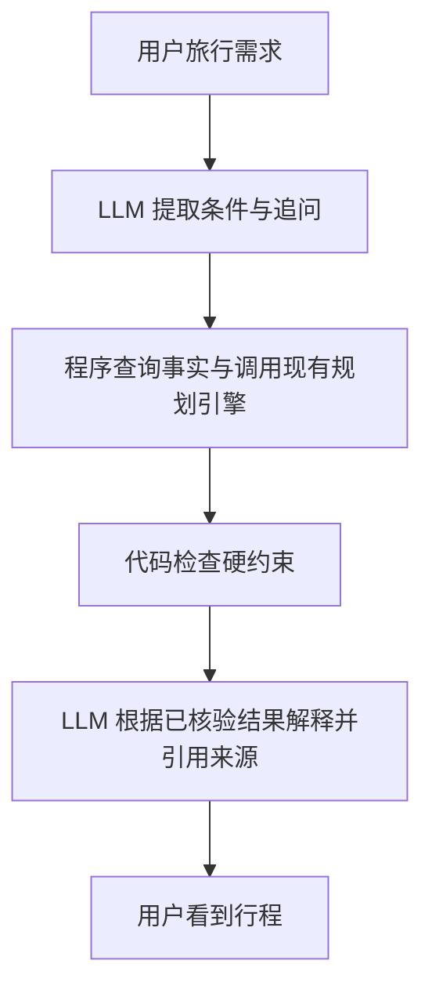

# NPS Guide Copilot 开发讨论与交接记录

更新日期：2026-10-16（America/Los_Angeles）

本文是本次对话的整理与工作记录，不是逐字聊天转录。用于后续开发交接；区分已确认事项、建议与实际验证结果。

## 1. 用户目标与工作方式

- 将 `D:\LLM\Team` 的 NPS Guide 作为 LLMOps 课程大作业的业务底座。
- 对照老师要求和自己的 proposal 逐步推进；先理解 LLM 与 LLMOps 的职责，再实现。
- 解释应使用具体旅行例子、流程图，避免只堆框架名称。
- 用户不希望目前依赖云端模型 API；以本地模型为主，同时保留云端 provider 接口。
- 用户已授权先做一次本地模型验证，并要求用 Markdown 记录讨论，供后续工作使用。

## 2. 参考文件与要求边界

老师要求：`C:\Users\ZJ\Desktop\CSYE7374_LLMOPS\projecctproposal.pdf`。

- 实现端到端 LLMOps 系统，强调自动化、可靠性、适应性。
- 明确要求简化 CI/CD：自动测试、版本管理与部署。
- 微调、多智能体、PromptOps、监控是可选方向，不要求全部实现。
- 文件中的工具是建议，不是强制技术栈。

个人计划：`C:\Users\ZJ\Desktop\CSYE7374_LLMOPS\Project_Proposal_NPS_Guide_Copilot.pdf`。

- 五个角色：Intake、Retriever、Planner、Critic、Writer。
- Python/FastAPI、LangGraph、Chroma、MLflow；复用 Node/TypeScript 行程引擎。
- 数据快照与 hash、版本化 prompts、provider 切换、约 150 条中英文 golden set。
- PR 评测门禁、Docker 发布、staging、回滚、定期更新公告。
- 这些是计划，不是当前已实现的功能。

## 3. 对现有底座的检查

现有系统包含景点数据、季节道路、预约、住宿、天气、行程排序、预算、离线地图与多语言界面。自动行程由确定性算法完成，当前未发现运行时 LLM 调用、agent 编排、模型评测体系或仓库内 GitHub Actions 工作流。

已执行检查：

- `npm test`：113/113 通过。
- `npx tsc --noEmit --incremental false`：通过。
- `npm run lint`：1 个错误，`scripts/i18n-en.mjs:48` 使用 `module` 变量名，触发 Next lint 规则。
- 未重新运行 production build；未完整验证浏览器流程、实时外部 API 或部署。
- 工作区原本已有大量景点、适合度和英文内容未提交修改；审查期间没有修改这些文件。

待处理的代码问题：

1. `src/app/api/weather/route.ts`：预警查询失败转换为 `[]`，无法区分无预警与获取失败。
2. `public/sw.js`：API 离线缓存的 `ignoreSearch: true` 回退可能匹配不同查询条件的数据。
3. `src/components/plan/planner.tsx`：生成时统一使用首座公园计算日出日落，应核查跨公园情况。
4. `src/lib/fetch-json.ts`：缺少应用级超时、响应运行时 schema 校验。
5. `src/lib/use-json.ts`：`useJsonAll` 已有 URL 不覆盖结果，首次失败后可能无法接受后续成功响应。
6. 行程页面与算法文件较大，应先抽出服务接口，避免 Python 重写一套规则。

以上为静态代码审查结论，其中行为问题尚未逐项做运行时复现。

## 4. 已解释的概念

- LLM：理解自然语言、提取条件、追问、选择工具、表达结果。
- 工具：由后端执行的程序，负责查关闭、算车程、规划路线；模型只提出调用请求。
- RAG：回答前检索资料。适合说明性文本；日期、许可、关闭等硬约束仍查结构化事实。
- LLMOps：管理上述模型应用的测试、版本、部署、监控与回滚；贯穿开发和运行，而非最后一步。
- 本地部署：运行已经训练好的模型，不等于微调或从零训练。
- 本地接口也属于 API，但不等于调用云端商业模型。
- 多个 agent 可以共享一个模型顺序调用，不需要同时加载五个模型。
- 固定函数流水线应称为 workflow；引入模型决策和工具选择后再准确描述 agent 能力。

LLMOps 管理链路：保存版本 → 自动评测 → 质量门禁 → 部署 → 运行记录 → 修复或回滚。

## 5. 技术路线与阶段边界

当前方向：保留 Next.js 界面和 TypeScript 规划引擎；新增 Python Copilot 服务；用薄 Node 服务复用算法；本地模型为默认 provider，云端 provider 保留但默认关闭，不自动回退到云端。

建议阶段（尚未全部实施）：

1. 定义 TripRequest / TripResult / Evidence 契约，封装规划工具，建立种子案例和基础 CI。
2. 最小 Copilot：自然语言 → 条件 → 工具 → 校验 → 解释。
3. 数据快照、来源、检索、有效期与更新冲突处理。
4. Planner/Critic 等多角色编排、有界修订、追踪。
5. 完整评测门禁、部署、回滚与对比实验。

第一版建议限制为黄石、大提顿、优胜美地，中文输入、明确日期、1–7 天；此为建议范围，不是已经实现的功能。

暂缓：重复建设 Streamlit UI、从零训练、没有明确收益依据的微调、继续扩大非核心网站功能。

## 6. 评测与 proposal 的修正建议

- 先少量人工核验样本跑通，再扩到约 150 条；记录数据版本。
- 不只评估违规率，也评估任务完成、适当追问、引用支持、延迟与费用。
- 固定快照回归与新事实适应测试分开，不能用旧标签惩罚正确响应新封路的答案。
- 增加同工具的单 agent 对照、无 Critic 消融，区分工具贡献与多 agent 贡献。
- mock provider 不证明真实模型质量；区分无密钥 CI 与真实模型评测。
- 退化 PR 应在 merge 前被门禁阻止；已发布退化版本使用回滚演示。
- 答案版本除快照 hash 外还应记录实时证据，否则不能完整复现。

## 7. 当前本地验证（已完成首轮）

实验目录：`experiments/local-model-validation/`（本机绝对路径：`D:\LLM\Team\experiments\local-model-validation`），所有验证材料统一位于 Team 内，不修改网站业务代码。

硬件实测：

- NVIDIA GeForce RTX 2070 with Max-Q Design，8192 MiB 显存。
- NVIDIA 驱动 610.62。
- 系统内存约 15.8 GiB；检查时可用约 4.1 GiB。
- D 盘检查时可用约 12 GB；下载与解压需要留意空间。
- PATH 和常用安装位置未发现 Ollama。

候选：Ollama + `qwen3:4b`（Q4_K_M，模型包约 2.5GB）；8B 留待对比。量化文件大小不等于总运行显存。先验证结构化条件提取，不据此宣称具备可靠工具调用、多 agent 或旅行事实判断能力。

实际使用 Ollama 官方 Windows 便携包 v0.40.5（约 1.47GB），Windows 数字签名 Valid，发布者 Ollama Inc.；未安装系统服务、未改 PATH。权重与运行文件放在独立目录。Ollama 首次启动可能在用户目录生成 `.ollama` 本机密钥。

服务：`127.0.0.1:11435`，日志确认 `OLLAMA_NO_CLOUD=true`。本轮未调用云端模型。固定模型 digest：`359d7dd4bcdab3d86b87d73ac27966f4dbb9f5efdfcc75d34a8764a09474fae7`。

参数：Q4_K_M，temperature=0，seed=42，num_ctx=4096，num_predict=512，think=false，单并发。使用 JSON Schema 约束输出。

首轮验证结果：

- 16 个预先编写的固定案例，5/16 完全通过，15/16 通过结构及日期合法性检查。
- 首次请求 75.762 秒（包含启动/加载）；后续 15 次请求中位耗时 1.259 秒，范围约 1.075–1.481 秒。
- 首次启动有 CUDA GPU 探测 watchdog 超时日志，随后恢复并加载 37/37 层至 GPU；应记录并在之后启动验证中复查。
- `/api/ps` 报告 `size_vram=3180247121`（约 2.96 GiB），与其报告的模型运行大小相同；采样时整卡占用 3729 MiB，约 3.64 GiB（包含桌面等其他占用，不是峰值测量）。
- 格式正确不代表语义正确：缺天数时补成 1 天；仅给月份时补成当月 1 日；缺公园时补出优胜美地；遗漏老人同行；日期范围与声称天数冲突未识别。
- 一个混合语言案例返回 `2:2027-09-02`，被日期合法性检查拒绝。
- 格式注入案例仍出现编造日期，不能据此宣称具备安全防护。
- 没有为提高分数而修改本轮 prompt 或标签；失败样本全部保留。

结论：这台机器能运行 4B 量化模型，并支持快速的简单单请求推理；当前这一套模型/prompt/参数组合的 Intake 准确性不够，不能直接信任其输出。此分数不是模型通用能力基准，也不能证明本地路线不可行。

完整结果：`D:\LLM\Team\experiments\local-model-validation\RESULTS.md`。

机器可读原始报告（含 prompt、schema、模型元信息、16 条输入/标签/输出和差异）：`D:\LLM\Team\experiments\local-model-validation\results\report.json`。

结束状态：测试后已调用本机接口卸载模型以释放显存；下载的权重与本机服务保留，后续请求可以重新加载模型。

运行脚本：`D:\LLM\Team\experiments\local-model-validation\validate.py`；运行说明：同目录 `README.md`。

建议下一步（尚未执行）：先把 ready/追问状态和字段一致性改为代码派生；对关键提取字段做证据校验；再用独立案例比较更简单的 prompt、开启思考模式或更大候选模型。不要在原来 16 条上反复调优后宣称泛化效果提升。8B 尚未下载或验证，CloudProvider 尚未实现。

## 8. 后续交接注意

- 用户明确要求全部验证材料归入 Team，已将完整实验目录（含模型权重、便携运行库、原始结果与脚本）搬入 `experiments/local-model-validation/`；原来的 Team 外实验目录已不存在。
- 搬迁前停止了旧路径的验证服务，首轮服务日志单独归档保留；历史原始日志中的旧路径是当时环境证据，不是新配置。
- 搬迁检查：原有 106 个文件全部存在，完整 16 条结果保留；所有操作文档与脚本不再引用旧运行目录。已从 Team 新路径重启本机服务，版本与模型 digest 和原验证一致，`/api/show` 可正常读取模型。健康检查记录见 `experiments/local-model-validation/migration-verification.json`；未重跑或覆盖首轮评测。
- 交接总入口为 [experiments/README.md](../experiments/README.md)，新机器的准备与复测步骤见该目录的运行说明。新增脚本使用自身所在目录定位文件。

- 阅读本文件时，先区分计划与已经验证的事实；不要把本地小样本通过当作项目验收通过。
- 对 Team 做实现前，读取 AGENTS.md 和相关目录说明；此仓库 Next 版本要求参考本地 Next 文档。
- 不覆盖已有未提交改动，不把模型权重和便携运行库提交 Git。
- 尚未授权发送 GitHub 评论、issue 或向其他人发送消息。
- 本地模型不依赖云端推理；实时 NPS/天气等数据依然可能联网。

## 9. 首轮结果后的改进讨论（建议，尚未实施）

用户先要求用流程图解释首轮测试，随后询问改进方式。已解释：16 条样本和预期标签提前写好，本地模型按规则提取条件，代码校验结构及日期并逐字段比较，再记录与汇总；没有调用网站行程算法，也没有让模型自评。

建议优先改职责边界，不立即更换模型：

1. LLM 先只抽取用户明确表达的条件，并给出原文片段；尽量减少同一次调用中的状态判定与日期算术。
2. 程序负责检查缺失字段、日期精度、日期范围与天数冲突，以及生成 ready/needs_clarification 状态。只有月份或缺少年份如何处理，是需要明确的产品规则；原基线选择追问，后续不应暗中改变标签标准。
3. 日期先保留用户原文（如“2027年10月”），再由程序解析为月份精度，不允许填补并未指定的日。字段原文证据必须出现在用户消息中；证据存在仍不能完全保证语义正确，需要额外检查与评测。
4. 为两个步骤分别评分：LLM 提取是否正确，程序校验/追问是否正确；同时报告整体流程结果，不能把新增代码校验带来的提升算作模型准确率提升。
5. 原 16 条保留为历史基线和回归集；新增一批未参与改提示词的案例，冻结规则与标签后比较。候选方案使用相同的新测试集，记录 prompt、模型和参数版本；保留不符合预期的失败样本。
6. 若职责简化后提取错误仍多，再分别比较思考开关或更大模型，记录质量、耗时与显存；8B 需要先检查实际资源，不保证在当前机器上顺畅运行。

提出以上建议时仅更新讨论记录；用户随后授权按此实现，实际结果见下一节。

## 10. V2 实施与实测（已完成）

用户授权：“好，按你的方法去做”。本轮在 `experiments/local-model-validation/v2/` 实现，没有改动网站业务代码或 V1 prompt、样本、原始结果。

实现：

- 模型只提取 parks/dates/duration/origin/pace/seniors 六类原文片段。
- `intake.py` 校验精确原文证据，完成别名映射、日期合法性和范围天数、缺失/冲突检查，代码产生状态；不会从整段用户消息补回模型遗漏字段。
- 单独记录规则测试、原文标注覆盖与完整流程三类结果；不把格式正确或保守追问等同于完整成功。
- 原 16 条用于回归，新增 16 条在模型调用前连同 prompt 与代码冻结 hash。48 次本地调用：V2 回归 16 次，新集 V1/V2 各 16 次。
- 新集和实现由同一作者编写且互相可见，不是严格独立盲测；没有根据本轮输出更改标签或调优。

结果：

| 项目 | V1 | V2 |
|---|---:|---:|
| 原 16 条完整流程 | 5/16（历史保留） | 15/16 |
| 新 16 条完整流程 | 3/16（本轮对照） | 13/16 |
| 新 16 条原文标注覆盖 | 不适用 | 13/16 |
| 新 16 条请求中位耗时 | 1.483 秒 | 1.269 秒 |

8 个规则单元测试通过，其中包括 32 条 gold 原文输入的子测试。模型仍会遗漏天数（六天、两天、four days），以及把出发城市误填为公园。部分错误被规则拦住，但遗漏可选字段与字段语义混淆仍是风险。上述提升属于完整工作流改进，不代表模型本身通用能力提升，也不能当作生产质量证明。

V2 运行 ID：`20261017T020042Z`（UTC）。可读报告见 [v2/RESULTS.md](../experiments/local-model-validation/v2/RESULTS.md)，全部 48 次原始调用、差异和 metadata 见该报告链接。原 V1 报告 hash 已核对未变。推理只访问本机 Ollama，没有调用云端模型。

后续尚未执行：字段级修复实验、思考模式/8B 对比、CloudProvider、网站和规划引擎接入、独立评测集与 CI 门禁。若继续改进，另建版本保留本轮冻结文件和失败记录。

### 用户要求查看实际输入输出

已从原 V2 报告导出 [全部 32 条输入输出](../experiments/local-model-validation/v2/INPUT_OUTPUTS.md)，失败项排在前面，保留模型原文、代码结果、期望与差异，没有重新运行或修改标签。

4 个完整流程失败的归因：1 个是把盐湖城填为公园，代码又将此当作不支持的公园；3 个是漏提取已提供的天数，导致多余追问。英文 packed 与标注 packed pace 的覆盖差异仅是引用长度差异，两者规范化相同，不应描述为真实节奏理解错误。当前状态与 missing_fields 只是验证输出，没有已接入的聊天 UI 或已发送的追问。

## 11. 用户提出的对话规则调整（待实现）

用户提出：未说年份时，应询问是否为当前年份（例如 2026）；普通用户未必会说“紧凑节奏”等术语，是否应先提供语言选项。

明确方向：

- 年份缺失应生成带候选年份的确认问句，而不是泛泛要求补年份，也不能静默填入当前年。候选年份是待确认建议，实际出发年份在用户确认前保持未知。
- 规划未来旅行时，要结合当前日期检查候选日期是否已过。以客户端 2026-10-16 为例，“12月19日”可问是否指 2026-12-19；“8月19日”今年已过，应说明并询问是否指 2027-08-19。不能一律套用今年，也不能擅自改成明年；回顾过去旅行的意图需另行区分。
- 相对日期计算应使用显式注入的 reference_date 与 timezone，测试固定时钟，避免依赖运行机器时间而漂移。用户确认后记录字段来源为 user_confirmation。
- 节奏使用“轻松玩 / 适中 / 多看一些”等用户可理解的选项并配具体行为描述，内部再映射 relaxed/normal/packed。
- 欢迎语可给非强制示例，用户自由表达优先；已明确偏好时不重复问。先了解基本需求，在生成前补问有必要的偏好，避免起手要求填写全部表单。
- “少走路”是步行负担，“不赶路”是时间安排，“多看景点”是行程密度，不能全部粗暴映射成单一 pace。带老人也不能直接等同于选择轻松节奏；这部分当前数据结构仅有 pace，后续需设计兼容字段。
- 若用户未表达偏好，可提供“先给适中草案、之后再调”的可跳过选项，并公开说明暂用假设。此为助手建议，尚未由用户确认最终交互文案。

本节仅记录需求和设计建议，没有修改 V1/V2 冻结样本、日期规则、代码或测试结果。后续应新建版本实现确认与多轮状态，再用新增测试验证，不能改写历史分数。

## 12. V3 多轮对话验证（已完成，仍有待修问题）

用户授权先按新的年份确认与节奏选项方法测试，并说明还能怎样改进。

实施在 `experiments/local-model-validation/v3/`：本地同一个 Qwen3 4B 非思考模式；模型仅提取当前消息原文，代码保存对话状态、产生追问和生活化选项。固定参考日期 2026-10-16 与 America/Los_Angeles，不用执行机器当前日期推断年份。确认前日期保持未知，记录字段来源；步行、赶路、早起、换酒店等偏好分别保存。

18 组预冻结脚本对话，共 36 轮；实际调用模型 21 次，整组 17/18、逐轮 35/36 通过。原文标注覆盖 18/20；调用中位耗时 1.058 秒，首次含加载 13.566 秒。6 个基础代码测试通过，含全部 gold 对话子测试。实际对话文案是代码模板，不是 LLM 自由生成；这不是独立用户试用，也不能与 V2 单轮分数直接比较。

真实失败：模型从“带老人”补造“少走路”，证据检查拒绝；但错误追问暴露 preferences 内部字段，并让用户承担模型错误。应该保留有效条件，正常询问偏好，或自然确认，而非输出实现细节。

主实验之后追加了 3 项探索性代码检查（给定正确提取，不调用模型），全部复现失败，单独保存，不混入主分数：

1. 拒绝候选日期后再回答模糊“是的”，错误确认原来的已拒绝候选。
2. 先给 2027年12月，再补 12月19日，丢掉原有年份并建议 2026。
3. 选项“2”可识别，但“我选第二种”不能绑定。

优先建议：修确认状态机和日期分量合并，再做可选字段异常的自然追问、自然选项指代、独立压力对话测试，之后才接行程引擎验证偏好生效。尚未进行这些后续修复，V3 冻结代码、失败与 V1/V2 历史报告均保留。

交接入口：[V3 RESULTS](../experiments/local-model-validation/v3/RESULTS.md)，链接包含 36 轮真实输入输出、完整原始记录和探索性检查。

## 13. 模型能力与参数规模的讨论（尚未下载 8B）

用户质疑继续修细节的价值，提出是否应提高模型本身能力、换更大参数。调整后建议：下一步重点转到同系列 4B/8B 模型对照，暂不继续围绕同一个 4B 追加零散规则。只有一个小模型的结果不足以确定最终选型。

区分：漏提取、指令遵循、自行推断偏好属于模型对照应关注的问题；候选年份被拒绝后仍被代码确认、日期状态覆盖等可以在不调用模型时复现，换模型不会自动修复。核心日期/确认规则仍须保留。

当前资源复查：RTX 2070 Max-Q 8GB，空闲显存 7353 MiB；系统内存约 15.82 GiB、可用约 3.58 GiB；D 盘空闲约 5.7 GiB。官方 Ollama `qwen3:8b` Q4_K_M 模型包约 5.2GB，文件大小不是总运行显存；上下文增大会增加内存需求。8B 可作为小上下文、单并发的试验候选，不承诺全 GPU 或性能。磁盘余量较小，下载前应先准备空间，不删除用户已有数据。

拟议下一实验（未执行）：另建版本，保持同一套 prompt/schema/代码和固定输入，先比较 4B 与 8B 非思考模式；若再比较思考开关，应单独作为变量记录。分别报告原始模型提取、完整流程、延迟、GPU/CPU 分配和显存，避免把规则收益当作模型能力收益。优先加入自然口语、改口、否定与多轮指代的新案例，并明确作者可见/非盲测限制。

本次仅复查资源和官方模型规格、记录方向；没有下载 8B、删除文件、修改冻结版本或运行新模型评测。

## 14. 其他模型候选调研（未下载、未实测）

用户询问是否有更好或更适合的模型。查阅官方模型卡与 Ollama 官方模型库后，建议将选型从“只增大 Qwen3 参数”扩展为“代际/家族/大小对照”；现有实测仅能代表 Qwen3 4B 的特定配置，不能直接推断其他模型优劣。

优先候选与定位：

1. Qwen3.5 4B Q4_K_M：官方提供工具和多语言支持，作为 8GB 显存机器上的新一代同规模候选优先测试。指定量化标签页面显示约 3.3GB；这不是运行总显存或所有平台包大小。
2. Qwen3 8B Q4_K_M：约 5.2GB，保留同系列参数规模对照价值。
3. Gemma 4 E2B：跨家族候选，官方支持函数调用、system 角色和多语言。Ollama llama.cpp 变体显示约 4.6GB。E2B 是有效参数命名，包含 embedding 的总参数更大，不应当作普通 2B 来估资源。
4. Qwen3.5 9B Q4_K_M：指定标签约 6.6GB，8GB GPU 上资源余量更紧，需准备磁盘并实测，不作为当前首个下载项。

上述多模态包可能还带 projector 等组件，文件大小不等于纯文本运行时占用；显存需求和 GPU/CPU 分配必须实测。官方介绍或基准不是本项目质量保证，不把模型系列大模型的分数挪用给小模型。更大参数、更新代际均不是单独的胜出依据。

建议试验次序：现有 Qwen3 4B 基线 → Qwen3.5 4B → Qwen3 8B；资源允许时补 Gemma 跨家族对照。先用相同任务、固定提示词与代码建立受控对照，再另行测试各模型官方推荐模板/采样，二者分开报告。还需真正加入工具选择与参数正确性测试，不能只看 JSON 字段提取。

来源（2026-10-16 查询）：

- https://huggingface.co/Qwen/Qwen3.5-4B
- https://ollama.com/library/qwen3.5:4b-q4_K_M
- https://ollama.com/library/qwen3.5:9b-q4_K_M
- https://ollama.com/library/qwen3:8b
- https://huggingface.co/google/gemma-4-E2B-it
- https://ollama.com/library/gemma4:e2b

本轮仅调研并记录，没有安装、下载或测试新的模型；没有宣布某候选已经在本机胜出。若能获得学校或自有 GPU 服务器，也可自托管更大模型并通过项目自有服务调用，不等于购买商业模型推理 API；是否具备服务器资源尚未确认。

## 15. Qwen3.5 4B 已下载并完成受控对照

用户授权：“好，那么先用3.5 4B看一下”。下载 `qwen3.5:4b-q4_K_M`，模型权重与 projector 共约 3.32GB，放在 Team 原模型目录，未删除旧模型。下载前 D 盘实际空闲约 20.52 GiB，空间足够；并非沿用上次的 5.7 GiB 数字。

新实验位于 `experiments/local-model-validation/model-comparison/`，保持 V2/V3 冻结提示词、schema、规则和样本不变，双方模型重跑。显式固定 temperature/seed/context/output 及 top_k/top_p/min_p/repeat/presence/frequency 参数，非思考模式；没有用候选默认采样与旧历史分数混比。

结果（运行 ID `20261017T034635Z`，UTC）：

| 同一任务 | Qwen3 4B | Qwen3.5 4B Q4 |
|---|---:|---:|
| V2 原回归集 | 15/16 | 12/16 |
| V2 新集 | 13/16 | 15/16 |
| V2 合计完整流程 | 28/32 | 27/32 |
| V3 多轮场景 | 17/18 | 18/18 |
| V3 逐轮断言 | 35/36 | 36/36 |
| V3 原文标注覆盖 | 18/20 | 17/20 |
| V3 模型调用中位耗时 | 1.347秒 | 1.427秒 |

候选改善：不再将盐湖城当公园，提取了部分原先漏掉的六天/four days，在 V3 中不再从带老人补造少走路。仍有退步：把旅行天数放到 dates、遗漏部分条件。另有 `6天` → `6 天` 被严格证据检查拒绝，是逐字契约/空白策略问题，不应当作不理解六天；本轮没有改标签或重新计分。

候选日志显示 33/33 层至 GPU，模型运行显存采样约 2.925 GiB；独立首次加载检查 79.291 秒，后续请求约 1–2 秒。运行完成后卸载模型释放显存，服务和两组权重保留，无云端推理。

64 条单轮执行、72 轮多轮执行及 2 次 preflight，共 107 次模型调用。3 个离线回放检查通过，V1/V2/V3 历史报告 hash 核对未变。评分按历史冻结规则，部分条件/原文覆盖指标不等于全部语义准确率；同一作者已有案例、单轮运行，不是盲测或通用模型排名。

结论：Qwen3.5 4B 是可运行且值得继续测试的候选，并非所有任务全面胜出。此前 3 个代码状态边界问题仍在。推荐未来加入独立自然表达和真实工具任务，或另测 8B/官方推荐采样，不再通过零散样本或空格差异决定模型优劣。

交接入口：[模型对照 RESULTS](../experiments/local-model-validation/model-comparison/RESULTS.md)，其中包含双方所有实际输入输出、参数、原始响应、字段差异及复测命令。
