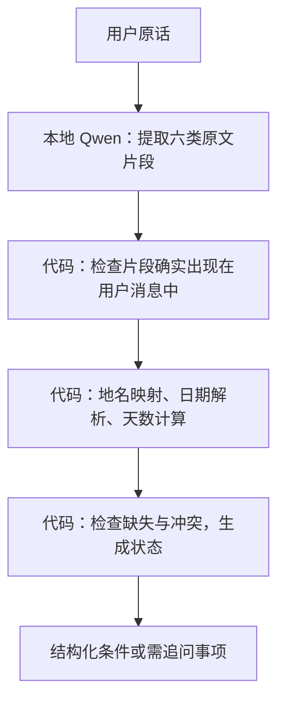

# V2：原文提取 + 确定性校验

本实验保留 V1 的模型与推理参数，改为由 LLM 复制原文证据，由 Python 解析条件并决定是否追问。没有接入网站，也没有训练或微调模型。

首轮 V2 已完成，查看 [实测结论与交接](RESULTS.md)；原回归集 15/16，新预冻结集 13/16，所有失败保留。

## 分工



模型仅输出 `parks`、`dates`、`duration`、`origin`、`pace`、`seniors` 原文，不生成公园代码、不计算日期范围天数、不输出 ready 状态。代码不从整个用户输入中补回模型漏提取的字段；仅使用输入定位证据、检查日期之间的连接词。

## 文件与运行

从本目录执行，需先按上一级说明启动 Ollama 并准备 `qwen3:4b`：

```powershell
# 不联网、不调用模型的代码测试
python -m unittest -v test_intake

# 本机模型评估；检查冻结摘要，新建独立运行目录，不覆盖原结果
python run.py
```

- `prompt.txt`：第二版提示词。
- `intake.py`：输出 schema、原文证据检查、标准化、日期与缺失/冲突规则。
- `regression-raw.json`：原 16 条的新增原文标注；标准化期望仍读上一级历史报告，保持原标准。
- `heldout.json`：16 条新案例，包含完整输入、原文标注与期望结果。
- `test_intake.py`：8 个单元测试，包含 32 条标注输入的子测试，以及编造日期、范围/闰年、超天数、未知出发地等检查。
- `unit-test-results.txt`：本次实际代码测试输出。
- `frozen-manifest.json`：首次 V2 推理之前固定的 prompt、案例与代码 SHA256。
- `runs/<UTC运行ID>/`：每次运行的 metadata、原始回答、字段差异、统计及可读报告。
- `LATEST_RUN.txt`：最近完成的运行 ID。

## 评分分三层

1. **规则层**：给定人工标注的正确提取片段，标准化代码能否得出正确字段和状态。通过不代表 LLM 正确。
2. **原文提取层**：模型片段是否来自用户原话，并覆盖标注的关键片段；容许较宽的原文引用。这是“标注片段覆盖”，不是完整的语义理解准确率；相同意思但比标注更短的引用也可能被判不覆盖。
3. **完整流程层**：模型输出经过代码校验后，与预先写好的旅行条件及状态逐字段比较。数组顺序不影响结果；旧 unsupported 案例沿用原先的部分字段标签，其余新案例检查全部字段。

状态字段由代码生成。原文不支持的提取被拒绝，并产生 `invalid_evidence`；需要追问的输出不能被当成已成功完成规划。模型遗漏可选的老人等条件仍可能造成错误，原文匹配不能证明字段语义正确。

## 对比设计与限制

- 原 V1 的 16 条完整报告原样保留；新代码记录并检查其 hash。
- V2 在原 16 条上做回归；在同一批新 16 条上交替运行 V1 与 V2，共 48 次本地调用。
- V1 使用首轮保存的 prompt/schema/参数；V2 改变了 prompt、输出结构及代码处理，比较的是完整方案，不是单一因素或模型本身能力提升。
- 新案例在推理前冻结，未根据本轮模型输出修改标签或调优。**同一作者编写并看过案例与代码，不能称作严格盲测或独立留出集**；文件名 heldout 沿用常见命名，报告使用“新预冻结集”。
- 仅一次运行，未测随机波动。延迟受模型加载、缓存与输入长度影响。
- 范围有限：三个公园、三个机场、1–14 天；日期支持显式完整中文日期、ISO 日期、完整英文月份日期。缺少年份、只有月份或季节不会补为某一天。自然语言纠正、复杂否定、相对日期和任意表达尚需扩展与测试。
- 不查询 NPS 或天气，不验证真实道路、行程生成、工具调用、RAG、多轮对话或多 agent。
- 若修改冻结文件，应作为新的实验版本保存；不要更新摘要后冒充原冻结实验。

## 云端与原始结果

所有模型调用仅访问 `127.0.0.1:11435`，云端推理保持关闭。模型 digest 必须与首轮报告一致。完整旧报告在 `../results/report.json`，不会被本实验覆盖。
